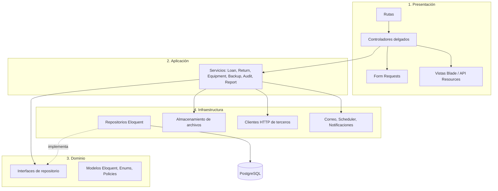

# Arquitectura por capas

PrestaLab usa cuatro capas. Una capa solo llama a la inmediata inferior.



## Reglas
- Los **controladores no consultan la BD**: validan con Form Requests, llaman a un servicio y devuelven una vista o un API Resource.
- Las **reglas de negocio y las transacciones** viven en los servicios.
- Los servicios dependen de **interfaces** (`app/Repositories/Contracts`); las implementaciones Eloquent (`app/Repositories/Eloquent`) se enlazan en `RepositoryServiceProvider`.
- La prueba `tests/Unit/ArquitecturaCapasTest.php` falla si un controlador usa `DB::`, `::query()` o modelos directamente.

## Carpetas bajo `app/`

```
app/
├─ Console/Commands/      Comandos artisan (create-admin, respaldo, vencimientos)
├─ Enums/                 Roles y estados (backed enums)
├─ Http/
│  ├─ Controllers/        Controladores delgados
│  ├─ Middleware/         Cabeceras de seguridad, roles, inactividad
│  ├─ Requests/           Form Requests (validación)
│  └─ Resources/          API Resources (JSON)
├─ Integrations/          Clientes HTTP de terceros (Turnstile, Google)
├─ Models/                Modelos Eloquent
├─ Notifications/         Correo y notificaciones internas (campana)
├─ Policies/              Autorización por rol
├─ Providers/             Incluye RepositoryServiceProvider
├─ Repositories/
│  ├─ Contracts/          Interfaces
│  └─ Eloquent/           Implementaciones PostgreSQL
└─ Services/              Reglas de negocio
```

## Interfaz: reglas de color
| Uso | Color |
|---|---|
| Identidad, menús, encabezados | Azul marino (`navy`) |
| Acción principal, Disponible | Verde (`brand`) |
| Prestado | Azul |
| Mantenimiento | Ámbar |
| Vencido, daño, acciones destructivas | Rojo (solo alertas) |